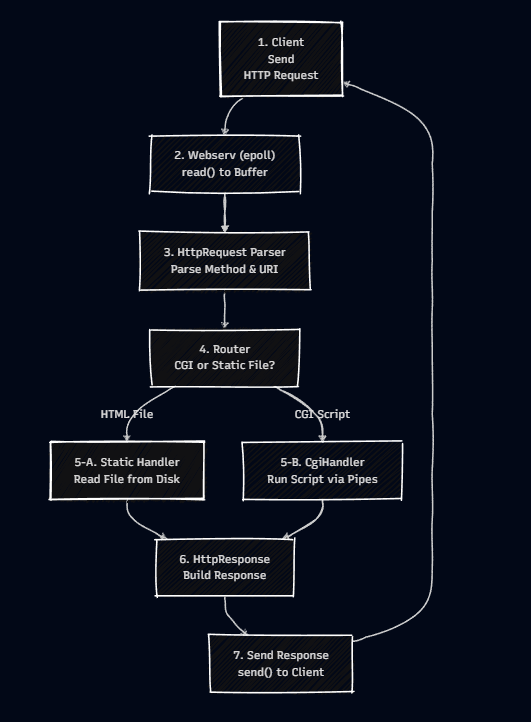
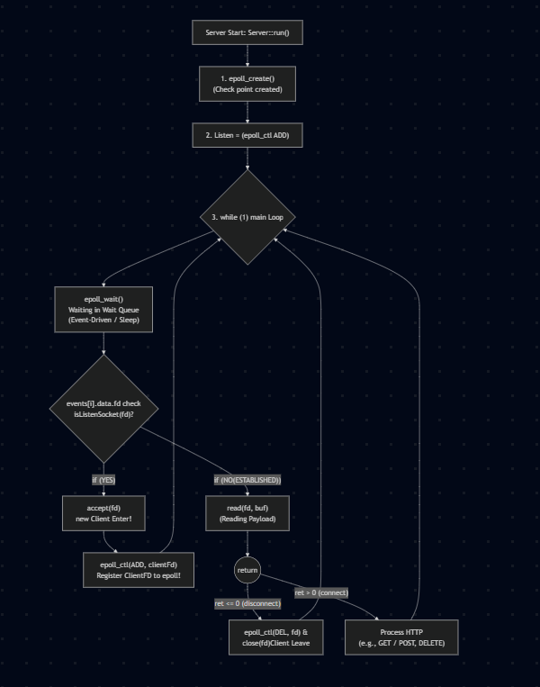
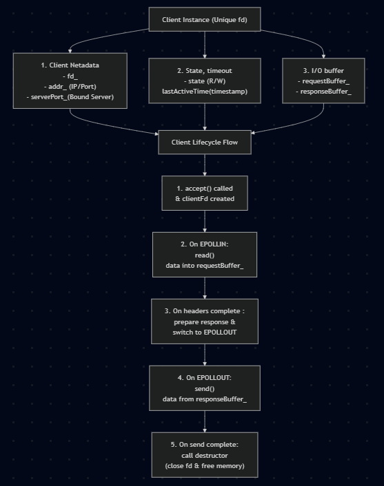
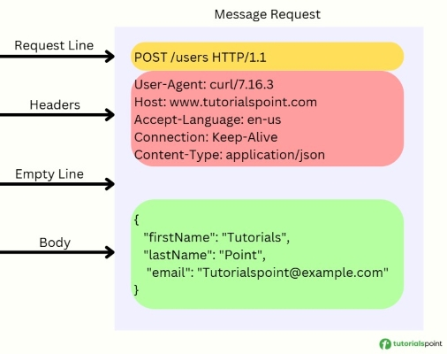
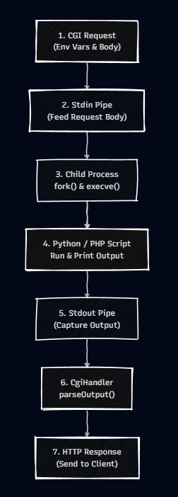

*This project has been created as part of the 42 curriculum by weiyuandu, jisookim.*

# webserv

`webserv` is an HTTP/1.1 server written in C++17. It serves static files, handles
file upload and deletion, optional directory listing (autoindex), HTTP redirects,
and CGI scripts (for example Python) through a single non-blocking `epoll` event
loop. Listening sockets, client sockets, and CGI pipes are all driven by the same
`epoll_wait` call.

## what is HTTP?

**HTTP server** is software designed to deliver web content to clients over a network using the TCP/IP protocol.  
It operates on a **Request-Response cycle**.  

1. **Connection** : Listens on specific network Ports (e.g., `80`, `443`) and accepts incoming TCP connections from Clients.  

2. **Request Parsing** : Reads and parses incoming HTTP/1.1 requests (Method, URI, Protocol Version, Headers, and optional Body).  

3. **Processing & Routing** : 
    -**Static Files** : Maps the requested URL to local filesystem paths to serve files (HTML, CSS) or `directory listings`(autoindex).
    -**CGI Handler** : For dynamic requests(e.g, `.py`), passes request parameters and body to an external CGI script via pipes and captures the output.
    It excute in a child process.

4. **Response** : Formats the result with appropriate HTTP status codes, headers, and body, transmiiting it back to the client.

## Overall Architecture

`webserv` is inspired by Nginx and built as an **single-threaded, non-blocking I/O, Asynchronous, event-driven** server by `epoll multiplexing`, `fcntl(fd, F_SETFL, O_NONBLOCK)`.



### Key Components :
- **Event Multiplexing(`Server::run`)** : A Single `epoll_wait()` manages all listening Sockets, active Client Connections, and inter-process CGI pipes without blocking or multi-threading overhead.  

- **CGI Handler** : Excutes scripts in isolated child Processes using non-blocking pipes by the main event loop.

- **Non-blocking & Event-Driven I/O** : All sockets and pipes are configured to non-blocking mode using `fcntl(O_NONBLOCK)`. 
The server never blocks or wastes CPU polling; instead, it reactively performs `read`/`write` operations only when `epoll` signals happend.  

## Server Architecture



The `Server` class is the main class of `webserv`.
It manages the lifecycle of network sockets and routes all I/O events through a single event loop.  

### 1. Initialization & Socket Binding  
- Parses `ServerConfig` : configurations from the config file. refered to Nginx config file format.
-  Binds a single non-blocking `ListenSocket` per unique `host:port` to prevent port collision (`Address already in use`), allowing multiple virtual servers to share the same port.  
  
### 2. Main Event Loop (`Server::run()`)
- Operates a unified `epoll_wait` loop that multiplexes:
  - **Listening sockets** (accepting new clients)
  - **Client sockets** (reading requests / sending responses)
  - **CGI pipes** (writing body to stdin / reading output from stdout)

### 3. Event Handler
- **New Connection** : Accepts clients in non-blocking mode and registers them for `EPOLLIN`.
- **I/O Routing** :
    - `handleClientRead()`: Buffers incoming data until request is complete.
    - `handleClientWrite()`: Sends responses in chunks using `EPOLLOUT`.
    - `handleCgiPipeEvent()`: Manages child process I/O.

### 4. Safety.
- **CGI Concurreny Limiting (`MAX_ACTIVE_CGI`)** : limits max number of active CGI processes to 2 to prevent Memory issue.
- **Timeout Monitors**: 
  - `checkCgiTimeouts()`: Terminates runaway CGI processes exceeding `CGI_EXECUTION_TIMEOUT_MS`.
  - `checkIdleClients()`: Cleans up inactive connections exceeding `CLIENT_IDLE_TIMEOUT_SEC`.

## Client Archtecture



The `Clinet` manages the state of a single client connection, including Buffers for both incoming requests and outgoing responses.  


## HTTP Request

The `HttpRequest` class parses raw bytes received by the client socket into structured HTTP/1.1 request data according to RFC 7230 standards.



The `HttpRequest` class parses raw bytes received by the client socket into structured HTTP/1.1 request data according to RFC 7230 standards.  

### 1. Request Line Parsing
- Extracts the **HTTP Method** (`GET`, `POST`, `DELETE`, `HEAD`), **Request-URI**, and **HTTP Version** (`HTTP/1.1`).
- Validates the URI and normalizes percent-encoded characters (URL decoding).  

### 2. Header Processing
- Parses key-value header pairs case-insensitively.
- Validates mandatory HTTP/1.1 headers (e.g., verifying that a single, valid `Host` header is present; returns `400 Bad Request` if missing or duplicated).  

### 3. Body Handling
- **Content-Length**: Reads the exact payload size specified by the header.  
- **Chunked Transfer Encoding**: Supports dynamic streaming requests by decoding `Transfer-Encoding: chunked` hex sizes and only data merg after de-chunking the body data.

## CGI Handler

The `CgiHandler` class handles the execution of CGI scripts in child process.
It use `pipe()` and `fork()` to execute scripts in isolated `child processes` and captures their `stdout` to construct the HTTP response.




## HTTP Response


## Instructions

### Build

```bash
make
```

Requires a Linux environment with `epoll` (the evaluation target). macOS does not
provide `sys/epoll.h`, so the full binary will not build there.

### Run

Always start from the **repository root** so relative `root` / `cgi_pass` paths
(e.g. `www`, `./cgi_tester`) resolve correctly:

```bash
./webserv [configuration file]
```

If no configuration file is given, the default is `configs/test.config`.

Listening is **IPv4 only** (`AF_INET` via `getaddrinfo`).

For a multi-port evaluation demo:

```bash
./webserv configs/eval.config
```

Then open `http://127.0.0.1:8080/` in a browser, or use `curl` against ports
`8080` and `8081`.

### Tests

```bash
./scripts/test.sh all
```

Individual modules: `./scripts/test.sh config`, `./scripts/test.sh cgi`,
`./scripts/test.sh http_request`, `./scripts/test.sh http_response`.

### Stress (on Linux)

See [docs/eval-checklist.md](docs/eval-checklist.md) for Siege and peer-evaluation steps.

## Resources

- [RFC 2616 / HTTP/1.1](https://www.rfc-editor.org/rfc/rfc2616) (reference subset)
- [NGINX Beginner’s Guide](https://nginx.org/en/docs/beginners_guide.html) (config behaviour comparison)
- [epoll(7)](https://man7.org/linux/man-pages/man7/epoll.7.html)
- [CGI /1.1](https://datatracker.ietf.org/doc/html/rfc3875)
